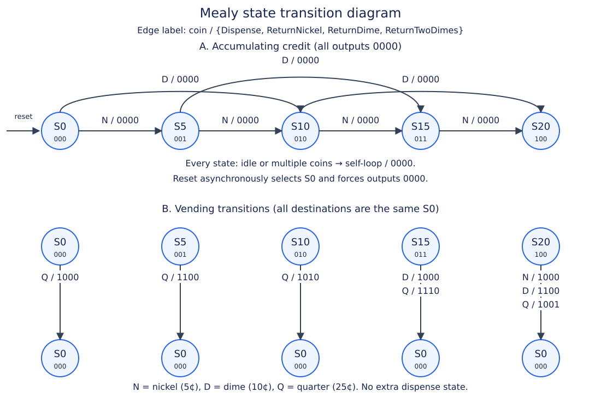
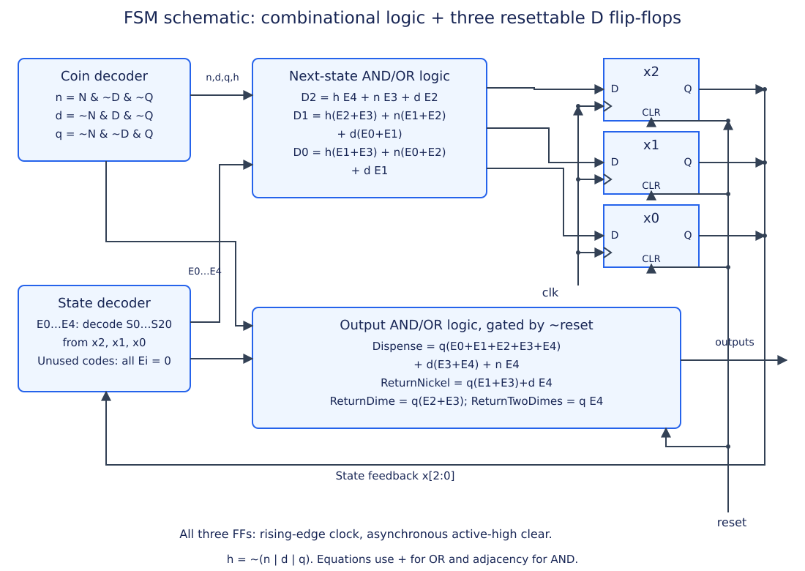
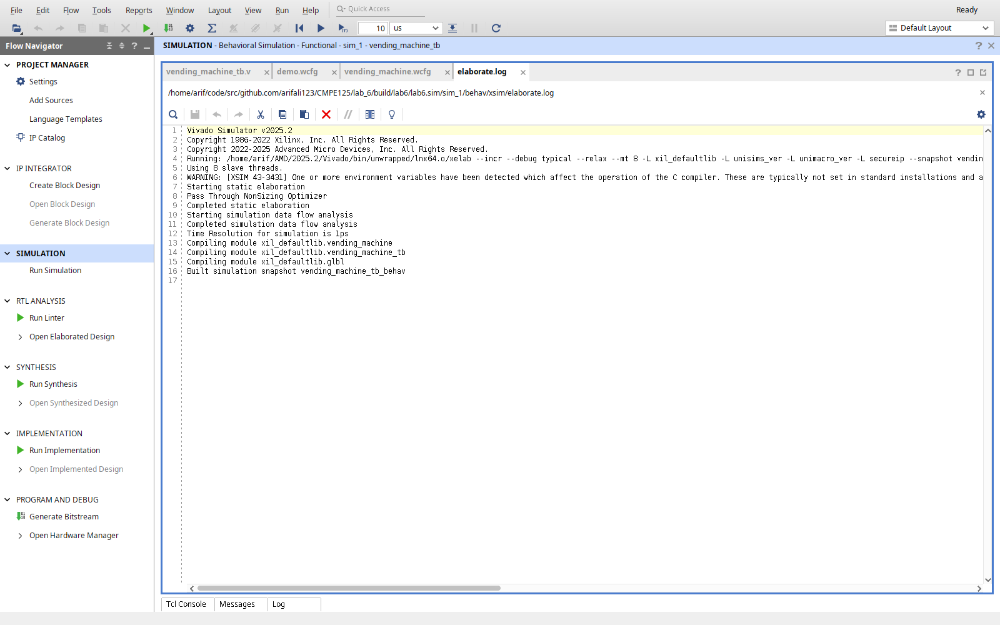
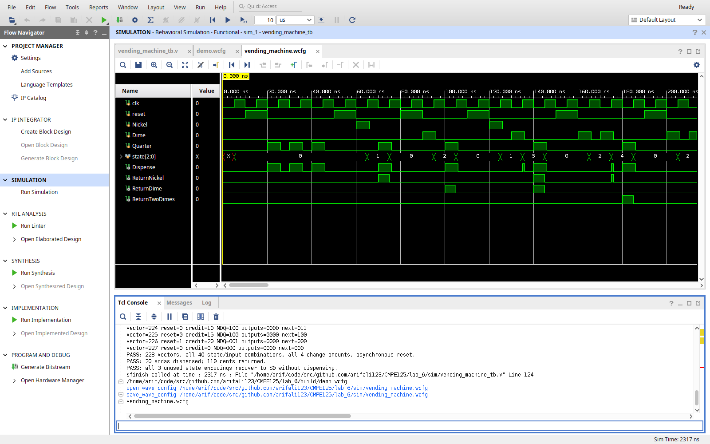

# Lab 6: Vending Machine FSM with Test Bench

CMPE 125 · Vivado 2025.2 · October 20, 2026

## Objective and design choices

Design a controller that accepts nickels, dimes, and quarters for a 25-cent
soda. When the current credit plus the inserted coin reaches or exceeds
25 cents, assert `Dispense`, return the excess, and prepare for the next
purchase. The handout permits either a Mealy or Moore FSM. This design uses a
Mealy FSM with five credit states and three state bits. Its outputs depend on
both the stored credit and the current coin, allowing another purchase on
the next clock without an extra dispense state.

`clk` samples on its rising edge. `reset` is active high and asynchronous,
clears the credit to zero, and suppresses all outputs. A synchronous consumer
samples the Mealy output with the coin at the rising edge; the outputs may
change immediately after the credit changes. The testbench therefore checks
outputs before the rising edge and checks the updated state afterward.
Coins are driven at falling edges and cleared 1 ns after their sampling edges.

The assignment assumes exactly one coin per cycle. The implementation also
defines idle (`Nickel,Dime,Quarter = 000`) and multiple-coin combinations:
credit holds and outputs are zero. Unused state encodings recover to `S0` on
the next rising edge and produce zero outputs before recovery. Reset clears
credit without issuing change; refund/cancel behavior is outside the handout.

## State transition diagram



The diagram is split into accumulation and vending views for readability.
Repeated `S0` nodes denote the same zero-credit state. Together the views
show every one-coin transition. The self-loop rule covers idle and all
multiple-coin inputs; reset overrides every transition.

## State encoding

| State | Stored credit | x2 x1 x0 |
|---|---:|:---:|
| S0 | 0 cents | 000 |
| S5 | 5 cents | 001 |
| S10 | 10 cents | 010 |
| S15 | 15 cents | 011 |
| S20 | 20 cents | 100 |
| Unused | Invalid | 101, 110, 111 |

Five states require `ceil(log2(5)) = 3` D flip-flops. Binary state encoding
represents credit divided by five. The RTL's `fsm_encoding = "none"`
attribute keeps the specified encoding during synthesis.

## State transition and output tables

Let `Y = {Dispense, ReturnNickel, ReturnDime, ReturnTwoDimes}`. A return value
of `1110` means dispense a soda and return one nickel plus one dime (15 cents).
`1001` returns two dimes (20 cents); `ReturnDime` stays zero in that case.

### Symbolic transitions

Each cell is **next state / Y**. `N`, `D`, and `Q` indicate exactly one coin.
`H` includes idle and invalid simultaneous-coin combinations.

| Present state | N (5 cents) | D (10 cents) | Q (25 cents) | H |
|---|---|---|---|---|
| S0 | S5 / 0000 | S10 / 0000 | S0 / 1000 | S0 / 0000 |
| S5 | S10 / 0000 | S15 / 0000 | S0 / 1100 | S5 / 0000 |
| S10 | S15 / 0000 | S20 / 0000 | S0 / 1010 | S10 / 0000 |
| S15 | S20 / 0000 | S0 / 1000 | S0 / 1110 | S15 / 0000 |
| S20 | S0 / 1000 | S0 / 1100 | S0 / 1001 | S20 / 0000 |

### Encoded transitions

Each cell is **D2 D1 D0 / Y**. Input columns use the raw order
`Nickel,Dime,Quarter`; `H = {000,011,101,110,111}`.

| x2 x1 x0 | N = 100 | D = 010 | Q = 001 | H |
|---|---|---|---|---|
| 000 | 001 / 0000 | 010 / 0000 | 000 / 1000 | 000 / 0000 |
| 001 | 010 / 0000 | 011 / 0000 | 000 / 1100 | 001 / 0000 |
| 010 | 011 / 0000 | 100 / 0000 | 000 / 1010 | 010 / 0000 |
| 011 | 100 / 0000 | 000 / 1000 | 000 / 1110 | 011 / 0000 |
| 100 | 000 / 1000 | 000 / 1100 | 000 / 1001 | 100 / 0000 |
| 101, 110, 111 | 000 / 0000 | 000 / 0000 | 000 / 0000 | 000 / 0000 |

For `reset=1`, every state and input combination selects `000` and `Y=0000`.
The asynchronous clear acts immediately, without waiting for a clock edge.

## Next-state and output logic

Use `+` for OR, adjacency for AND, and `~` for NOT. Lowercase `n`, `d`, and
`q` decode exactly one asserted coin input. Capital `N`, `D`, and `Q` here
refer to the raw Nickel, Dime, and Quarter input pins.

```text
n = N ~D ~Q
d = ~N D ~Q
q = ~N ~D Q
h = ~(n + d + q)

E0 = ~x2 ~x1 ~x0
E1 = ~x2 ~x1  x0
E2 = ~x2  x1 ~x0
E3 = ~x2  x1  x0
E4 =  x2 ~x1 ~x0
```

The state decoders `E0` through `E4` correspond to `S0` through `S20`.
They all evaluate to zero for an unused encoding. For `reset=0`, the D inputs
are obtained by OR-ing all transition terms whose destination has that bit set:

```text
D2 = h E4 + n E3 + d E2
D1 = h(E2 + E3) + n(E1 + E2) + d(E0 + E1)
D0 = h(E1 + E3) + n(E0 + E2) + d E1
```

For example, `D2=1` only when holding at 20 cents, adding a nickel at
15 cents, or adding a dime at 10 cents. Every vending transition has
`D2 D1 D0 = 000`. The resettable FFs implement `x_next = 000` while reset is
asserted; the RTL also sets the combinational `next_state` to zero during reset.

```text
Dispense = ~reset [q(E0+E1+E2+E3+E4) + d(E3+E4) + n E4]
ReturnNickel = ~reset [q(E1+E3) + d E4]
ReturnDime = ~reset [q(E2+E3)]
ReturnTwoDimes = ~reset [q E4]
```

The maximum stored credit is 20 cents. Adding the largest coin, a quarter,
produces 45 cents, so the largest required change is 20 cents. The output
combinations represent every possible change: 0, 5, 10, 15, and 20 cents.

## Schematic and Verilog implementation



The coin decoder and five state decoders feed the AND/OR networks shown in
the equations. Three positive-edge D flip-flops store `x2,x1,x0`, share `clk`,
and share asynchronous active-high clear. Their Q outputs feed back into the
state decoder. Separate combinational output logic produces all four
actuator signals and is gated by `~reset`.

The synthesizable source is [vending_machine.v](../rtl/vending_machine.v).
It uses one sequential block with nonblocking assignments and one
combinational block with blocking assignments and defaults. Every branch
assigns or retains a defined next state and all outputs have defaults,
avoiding inferred latches. The unused-state default recovers to zero credit.
The design is a controller with synchronous coin sampling; a physical coin
sensor would require its own synchronization and pulse generation.

## Test vectors and testbench

The [testbench](../sim/vending_machine_tb.v) extends Lab 5's Type 3
`$readmemb` approach. Inputs and expected results reside in the separate
[test_vector.tv](../sim/test_vector.tv) file. Each 11-bit row has this format:

```text
reset_NDQ_expectedOutputs_expectedState
  1    3         4              3        bits
```

For example, after one dime has established `S10`, the row
`0_001_1010_000` applies a quarter, expects `Dispense=1` and
`ReturnDime=1`, and expects `S0` after the rising edge. Underscores and
`//` comments are accepted by `$readmemb`.

The testbench loads exactly 228 vectors. It drives each row at a falling
edge, waits 1 ns, and compares all four Mealy outputs with case inequality
(`!==`) so unknown outputs fail. It checks asynchronous reset at that same
point, before the next clock. After the rising edge it waits 1 ns and checks
the state. It then clears the coin, waits 1 ns, and verifies that no output
remains asserted. An independent cents-based arithmetic model checks the
expected outputs and next state in the vector file itself.

### Directed transaction examples

| Coin sequence | Total through vending coin | Change | Y on vending coin |
|---|---:|---:|:---:|
| Q | 25 cents | 0 cents | 1000 |
| N, Q | 30 cents | 5 cents | 1100 |
| D, Q | 35 cents | 10 cents | 1010 |
| N, D, Q | 40 cents | 15 cents | 1110 |
| D, D, Q | 45 cents | 20 cents | 1001 |
| D, D, D | 30 cents | 5 cents | 1100 |
| N, N, N, N, N | 25 cents | 0 cents | 1000 |

The handout lists `Q+D`, six nickels, and `D+D+N+N` as possible overpayment
examples. Under its immediate-vend rule, `Q` alone already buys a soda,
the fifth nickel already buys a soda, and `D+D+N` already buys a soda.
The remaining coin belongs to the next purchase. The vector file includes
these sequences and checks those exact boundaries. Actual overpayment is
covered by `D+Q`, `D+D+D`, and the other examples above.

### Coverage and failure handling

After directed transactions, the file visits each of the five credit states
and applies all eight raw coin input combinations: 40 state/input pairs.
A coverage bitmap requires every pair to have been checked. A second bitmap
requires all nonzero change amounts: 5, 10, 15, and 20 cents. Additional
vectors assert reset from each credit state while a quarter is present,
checking reset priority and suppression of dispense/change.

After the vector file, three fault-injection tests force the unused encodings
`101`, `110`, and `111`, verify zero outputs even with a quarter, release the
force, and verify recovery to `S0` at the next rising edge. Fault injection
is simulation-only. Missing vectors, mismatched expectations, output/state
errors, incomplete coverage, unsafe state recovery, and timeout all stop
with `$fatal`. Purchases need no inserted recovery cycle; consecutive
quarters verify consecutive vending cycles.

## Compilation and simulation results

Verification was performed locally with **Vivado/XSim 2025.2** targeting
`xc7a35tcpg236-1`. The design and testbench compiled and elaborated successfully.
Synthesis also completed with zero warnings or errors, using three
asynchronously cleared flip-flops, ten LUT sites, and zero latches.
Simulation completed at **2317 ns**. The final transcript was:

```text
PASS: 228 vectors, all 40 state/input combinations, all 4 change amounts, asynchronous reset.
PASS: 20 sodas dispensed; 110 cents returned.
PASS: all 3 unused state encodings recover to S0 without dispensing.
```

The soda/change totals refer to the vector tests. Three unused-state checks
follow them and are excluded from the purchase totals. XSim issued an
environment warning about the host's `LIBRARY_PATH`; compilation,
elaboration, and the self-checks completed successfully.

### Compilation evidence



### Waveform and self-checking simulation evidence



The directed tests at the beginning of the waveform show a quarter vending
with no change, followed by return values of 5, 10, 15, and 20 cents. The
state returns to `000` at each vending edge. Observe the output immediately
before the rising edge because this is a Mealy controller.

To reproduce the verification from the repository root:

```sh
mkdir -p lab_6/build
(cd lab_6/build && vivado -mode batch -source ../scripts/verify.tcl)
```

To inspect interactively, run `./lab open lab_6` and select **Run Simulation >
Run Behavioral Simulation**. The project marks `test_vector.tv` as a memory
initialization file so Vivado copies it to the simulation working directory.
The code and vectors remain portable when the repository moves.

## Conclusion

The five-state controller dispenses at 25 cents, returns the correct change
for every reachable excess amount, and immediately resets its credit for
the next purchase. File-driven tests verified every state/input combination,
all change outputs, asynchronous reset, consecutive purchases, and recovery
from unused state encodings.

The provided handout references a separate Canvas report guideline which was
not attached. This report includes the design artifacts, source files,
vectors, and actual tool evidence requested in the handout; cover-page and
submission formatting should be checked against that separate guideline.
